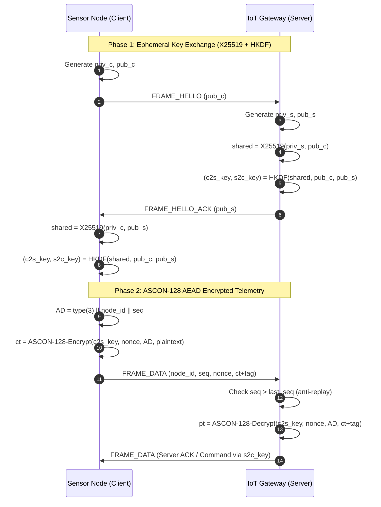

# ASCON+: Scalable Multi-Node ASCON-Secured IoT Communication

ASCON+ is a lightweight, forward-secure IoT session protocol engineered for resource-constrained edge devices (e.g., Raspberry Pi Zero W) communicating with an edge gateway. It combines **ephemeral X25519 ECDH key agreement**, **HKDF-SHA256 directional derivation**, and **NIST-standardized ASCON-128 AEAD** to eliminate plaintext symmetric key exposure while preserving minimal compute and memory overhead.

## Protocol Architecture & Exchange



## Quick Start

```bash
# 1. Start the IoT Gateway Server
python apps/gateway_server.py --host 127.0.0.1 --port 9000

# 2. In another terminal, run an IoT Sensor Node
python apps/node_client.py --node-id 1 --host 127.0.0.1 --port 9000 --count 10 --interval 0.5
```

## Execution Commands

- **Run Automated Verification & Test Vectors** (67 tests across 6 suites):
  ```bash
  python -m pytest -v
  ```
- **Run Microbenchmarks & Empirical Analysis** (Crypto, Memory, E2E):
  ```bash
  bash scripts/run_benchmarks.sh
  ```
- **Run Discrete-Event Gateway Scalability Study** (SimPy):
  ```bash
  bash scripts/run_sim.sh
  ```
- **Generate CupCarbon Wireless Simulation Scenarios** ($N \in \{5, 10, 25, 50\}$):
  ```bash
  python simulation/cupcarbon/generate_scenarios.py
  ```
- **Run on Raspberry Pi Zero W**:
  ```bash
  bash scripts/pi_run.sh
  ```

## Results & Evidence Locations

- **Formal Verification & Vectors Matrix**: [`docs/VALIDATION.md`](file:///c:/Users/thanu/OneDrive/Desktop/ASCONplus/docs/VALIDATION.md)
- **Comprehensive Outcomes Report**: [`docs/RESULTS.md`](file:///c:/Users/thanu/OneDrive/Desktop/ASCONplus/docs/RESULTS.md)
- **Raw Measurements**: [`results/raw/`](file:///c:/Users/thanu/OneDrive/Desktop/ASCONplus/results/raw) (`crypto_*.csv`, `e2e_*.csv`, `memory_*.csv`, `sim_*.csv`)
- **Statistical Summaries**: [`results/processed/`](file:///c:/Users/thanu/OneDrive/Desktop/ASCONplus/results/processed) (`summary.md`, `sim_summary.md`)
- **Visual Plots**: [`results/figures/`](file:///c:/Users/thanu/OneDrive/Desktop/ASCONplus/results/figures) (`handshake_time.png`, `sim_p99_vs_N.png`, `sim_utilization_vs_N.png`)

## Limitations

1. **Pure-Python Overhead**: Pure-Python `ascon` is functional but slower than optimized C/assembly.
2. **Platform Scaling**: Development workstation timings differ from ARMv6 Pi Zero W hardware ($10\times$–$50\times$ gap modeled in sensitivity study).
3. **CupCarbon Scope**: CupCarbon models wireless ZigBee path loss/collisions, not CPU cryptographic queue dynamics.
4. **Adversary Model**: Unauthenticated Stage 2 mode protects against passive wire eavesdroppers; active MITM defense requires PSK authentication mode (`ascon_plus/auth.py`).
